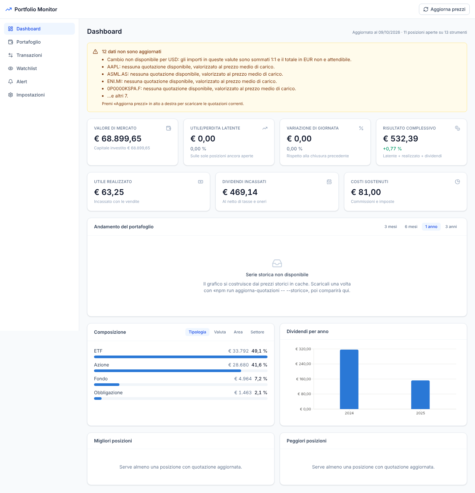

# Portfolio Monitor

Applicazione web per monitorare un portafoglio di **azioni, fondi ed ETF, americani ed europei**:
posizioni, prezzo medio di carico, utile/perdita, dividendi, composizione e watchlist, con i prezzi
scaricati automaticamente e tutto in una valuta base a scelta.

Gira **in locale**: i dati stanno in un file SQLite sul tuo computer, nessun account, nessun servizio
esterno a cui affidare il portafoglio.



---

## Cosa fa

- **Posizioni sempre derivate dalle transazioni** — registri acquisti, vendite, dividendi, commissioni
  e split; quantità, prezzo medio di carico (costo medio ponderato), utile realizzato e latente si
  ricalcolano da soli. Non esiste un saldo da tenere allineato a mano.
- **Multivaluta** — ogni titolo resta nella sua valuta, i totali vengono convertiti nella valuta base
  (EUR di default) ai cambi ufficiali BCE.
- **Prezzi da più fonti con fallback** — Yahoo Finance come fonte primaria, Twelve Data come riserva,
  BCE per i cambi. Se una fonte cade, si passa alla successiva.
- **Dashboard** — valore di mercato, utile latente, variazione di giornata, risultato complessivo,
  andamento storico, composizione per tipologia/valuta/area/settore, migliori e peggiori posizioni.
- **Dividendi** — riepilogo per anno e per titolo, al netto di imposte e oneri.
- **Watchlist e alert** — titoli osservati con prezzo obiettivo, e soglie di prezzo che scattano
  all'aggiornamento delle quotazioni.
- **Import/export CSV** — importa il tracciato del tuo intermediario (riconosce separatore `,` `;` o
  tab, date italiane e numeri con la virgola) ed esporta tutto quando vuoi.

### Cosa NON fa

Non è uno strumento fiscale: non calcola plusvalenze ai fini dichiarativi, non applica il regime
amministrato né gestisce il *quadro RW*. I prezzi vengono da fonti pubbliche gratuite, possono essere
differiti o incompleti e non sostituiscono la rendicontazione dell'intermediario.

---

## Avvio rapido

Serve **Node.js 20 o superiore** ([nodejs.org](https://nodejs.org)).

```bash
git clone <url-del-repository>
cd portfolio-monitor

npm install                 # installa backend e frontend
cp .env.example .env        # configurazione (va bene anche così com'è)

npm run seed                # facoltativo: portafoglio di esempio per provare l'app
npm run aggiorna-quotazioni -- --storico   # scarica prezzi correnti e 2 anni di storico

npm run dev                 # avvia tutto
```

Poi apri **http://localhost:5173**.

> `npm run seed` inserisce 13 strumenti di esempio (azioni USA ed europee, ETF, un fondo, un
> obbligazionario) con transazioni realistiche. Per ripartire da zero: `npm run seed -- --reset`,
> oppure cancella il file `data/portfolio.db`.

### Uso in produzione (sempre in locale)

```bash
npm run build
npm start                   # http://localhost:4000, backend + frontend in un solo processo
```

---

## Configurazione

Tutto in `.env` alla radice del progetto (parti da `.env.example`).

| Variabile | Default | A cosa serve |
|---|---|---|
| `BACKEND_PORT` | `4000` | Porta del server |
| `DATABASE_PATH` | `./data/portfolio.db` | File SQLite con i tuoi dati |
| `VALUTA_BASE` | `EUR` | Valuta dei totali (modificabile anche da Impostazioni) |
| `PROVIDER_ORDINE` | `yahoo,twelvedata` | Ordine di tentativo per quotazioni e storico |
| `FX_PROVIDER_ORDINE` | `frankfurter,yahoo,twelvedata` | Ordine di tentativo per i cambi |
| `TWELVEDATA_API_KEY` | *(vuoto)* | Chiave per il provider di riserva |
| `QUOTAZIONE_TTL_SECONDI` | `900` | Quanto a lungo riusare una quotazione prima di riscaricarla |
| `CRON_AGGIORNAMENTO` | `0 19 * * 1-5` | Aggiornamento automatico; lascia **vuoto** per disattivarlo |

### Le fonti dei prezzi

| Fonte | Chiave | Copertura | Note |
|---|---|---|---|
| **Yahoo Finance** | no | Azioni, ETF e fondi USA ed Europa | Interfaccia **non ufficiale**: può cambiare senza preavviso |
| **Twelve Data** | sì, gratuita | Azioni ed ETF, buona copertura europea | ~800 chiamate/giorno sul piano free |
| **BCE** (frankfurter.app) | no | Solo tassi di cambio | Fonte ufficiale, nessun limite |

Yahoo da solo basta per iniziare. Dato che è un'interfaccia non ufficiale, **conviene configurare
anche Twelve Data**: registra una chiave gratuita su [twelvedata.com](https://twelvedata.com/pricing)
e mettila in `TWELVEDATA_API_KEY`. Quando Yahoo non risponde, l'app passa automaticamente all'altra
senza che tu debba fare nulla.

### Come si scrivono i simboli

Si usa il **formato Yahoo**: ticker, più il suffisso della borsa per i mercati non americani.
La conversione verso Twelve Data è automatica.

| Mercato | Suffisso | Esempio |
|---|---|---|
| USA (NASDAQ, NYSE) | nessuno | `AAPL`, `VOO` |
| Borsa Italiana | `.MI` | `ENI.MI`, `SWDA.MI` |
| Xetra (Germania) | `.DE` | `SAP.DE`, `VWCE.DE` |
| Euronext Parigi | `.PA` | `AIR.PA` |
| Euronext Amsterdam | `.AS` | `ASML.AS` |
| Londra | `.L` | `SHEL.L` |
| Svizzera | `.SW` | `NESN.SW` |
| Madrid | `.MC` | `SAN.MC` |

Non ricordi il simbolo? In **Portafoglio → Nuovo strumento** c'è la ricerca per nome o ISIN.

---

## Import CSV

Da **Transazioni → Importa CSV**. Esempi pronti in `data-samples/`.

L'importatore riconosce da solo il separatore (`,`, `;`, tab), le date `GG/MM/AAAA` o `AAAA-MM-GG`,
e i numeri in formato italiano (`1.234,56`) o inglese (`1,234.56`). Gli strumenti non ancora in
anagrafica vengono creati al volo.

**Colonne obbligatorie:** `simbolo`, `tipo`, `data`.
**Facoltative:** `nome`, `isin`, `tipo_strumento`, `quantita`, `prezzo`, `commissioni`, `tasse`,
`valuta`, `note`.

Sono accettati anche i nomi inglesi e alcune varianti italiane comuni (`ticker`/`symbol`,
`operazione`/`movimento` per `tipo`, `quantità`/`qty`/`pezzi`, `price`, `fees`, `imposte`…).

```csv
simbolo,tipo,data,quantita,prezzo,commissioni,valuta
AAPL,ACQUISTO,12/03/2024,25,172.40,7,USD
ENI.MI,ACQUISTO,18/01/2024,400,14.12,5,EUR
```

Una riga sbagliata non blocca le altre: a fine import l'app dice quante ne ha scartate e perché.

---

## Come vengono calcolati i numeri

| Voce | Come |
|---|---|
| **Prezzo medio di carico** | Costo medio ponderato. Le commissioni di acquisto entrano nel costo; una vendita **non** modifica il prezzo medio. |
| **Utile latente** | `(prezzo attuale − prezzo medio) × quantità`, convertito in valuta base. |
| **Utile realizzato** | Alla vendita: `ricavo netto − (quantità venduta × prezzo medio)`. |
| **Dividendi** | `quantità × dividendo per azione − imposte`. Per un accredito unico, metti l'importo in `prezzo` e lascia `quantita` a 0. |
| **Split** | Il rapporto va nel campo quantità: `4` per uno split 4:1, `0.1` per un raggruppamento 1:10. Quantità e prezzo medio si rettificano, il costo totale resta invariato. |
| **Risultato complessivo** | Latente + realizzato + dividendi. |

Quando manca la quotazione di un titolo, la riga viene valorizzata **al costo** (utile 0) e la
dashboard lo segnala: meglio un totale dichiaratamente incompleto che un valore inventato.

La logica contabile è coperta da test: `npm test`.

---

## Aggiornamento automatico dei prezzi

Mentre l'app è in esecuzione, lo scheduler interno aggiorna le quotazioni secondo
`CRON_AGGIORNAMENTO` (default: 19:00 nei giorni feriali, a mercati europei chiusi).

Se non tieni l'app sempre accesa, richiama lo script da fuori:

```bash
npm run aggiorna-quotazioni              # solo prezzi correnti
npm run aggiorna-quotazioni -- --storico # anche 2 anni di storico (serve una volta sola)
```

Su Linux/macOS, con `crontab -e`:

```
0 19 * * 1-5 cd /percorso/di/portfolio-monitor && npm run aggiorna-quotazioni
```

Su Windows si usa l'Utilità di pianificazione con lo stesso comando.

---

## Backup

Tutto sta in un file: `data/portfolio.db`. Con l'app **spenta**, copialo (insieme a eventuali
`-wal` e `-shm` nella stessa cartella) e hai il backup completo.

In alternativa, **Transazioni → Esporta CSV** produce un file reimportabile da questa stessa app.

---

## Struttura del progetto

```
portfolio-monitor/
├── backend/                 API Express + SQLite
│   ├── src/
│   │   ├── providers/       Yahoo, Twelve Data, BCE + catena di fallback
│   │   ├── services/        posizioni, quotazioni, cambi, valutazione, CSV
│   │   ├── routes/          endpoint REST
│   │   └── db/              schema SQL e connessione
│   ├── scripts/             seed, aggiornamento quotazioni
│   └── test/                test della logica contabile
├── frontend/                React + Vite + Tailwind
│   └── src/
│       ├── pages/           dashboard, portafoglio, transazioni, watchlist, alert, impostazioni
│       ├── components/      UI condivisa e grafici
│       └── lib/             client API, tipi, formattatori
└── data-samples/            CSV di esempio per l'import
```

### Comandi

| Comando | Cosa fa |
|---|---|
| `npm run dev` | Backend (:4000) + frontend (:5173) insieme |
| `npm run build` | Compila entrambi |
| `npm start` | Avvia la versione compilata (un solo processo) |
| `npm test` | Test della logica contabile |
| `npm run typecheck` | Controllo dei tipi su tutto il progetto |
| `npm run seed` | Portafoglio di esempio (`-- --reset` per azzerare prima) |
| `npm run aggiorna-quotazioni` | Scarica i prezzi (`-- --storico` anche lo storico) |

### API

Tutti gli endpoint sotto `/api`:

| Metodo | Percorso | Descrizione |
|---|---|---|
| `GET` | `/salute` | Stato del server |
| `GET` `POST` | `/strumenti` | Elenco con posizioni / creazione |
| `GET` | `/strumenti/ricerca?q=` | Ricerca simboli sui provider |
| `GET` `PUT` `DELETE` | `/strumenti/:id` | Dettaglio / modifica / eliminazione |
| `GET` | `/strumenti/:id/storico?giorni=` | Serie storica dei prezzi |
| `GET` `POST` | `/transazioni` | Elenco filtrabile / inserimento |
| `POST` | `/transazioni/import` | Import CSV |
| `GET` | `/transazioni/export.csv` | Export CSV |
| `GET` | `/portafoglio` | Valutazione completa |
| `GET` | `/portafoglio/andamento?giorni=` | Serie storica del portafoglio |
| `GET` | `/portafoglio/dividendi` | Riepilogo dividendi |
| `POST` | `/portafoglio/aggiorna` | Scarica tutte le quotazioni |
| `GET` `POST` `PUT` `DELETE` | `/watchlist` | Gestione watchlist |
| `GET` `POST` `DELETE` | `/alert` | Gestione soglie di prezzo |
| `GET` `PUT` | `/impostazioni` | Preferenze |

---

## Problemi frequenti

**«Nessuna quotazione disponibile» su tutti i titoli**
Non c'è rete verso i provider, oppure Yahoo ha cambiato interfaccia. Configura
`TWELVEDATA_API_KEY` per avere la riserva. Il messaggio d'errore dell'app riporta il motivo
specifico di ciascuna fonte.

**Un singolo titolo non si aggiorna**
Quasi sempre è il simbolo. Verificalo con la ricerca in «Nuovo strumento»: i fondi comuni in
particolare hanno codici Yahoo poco intuitivi (es. `0P0000KSPA.F`).

**Il grafico di andamento resta vuoto**
Si costruisce dai prezzi storici in cache locale. Scaricali con
`npm run aggiorna-quotazioni -- --storico`.

**I totali in euro sembrano sbagliati con titoli in dollari**
Se il cambio non è recuperabile, la dashboard lo dice esplicitamente e somma 1:1. Appena la rete
torna, il totale si corregge da solo.

---

## Licenza

Uso personale.
